<p align="center">
  
</p>

<div align="center">

<b>中文</b> · <a href="./README.en.md">English</a>

### dsh-adult-tension<br>专为高张力、强连续性的成人互动叙事打造

<p>
<strong>18+ 深度破甲 · Claude Opus 5.5 重构</strong><br>
原生 Agent Skill ｜ 活人感 NPC<br>
数千余项素材库 ｜ 零漂移 SQLite 状态机<br>
<sub>——这里没有百依百顺的玩偶，只有各怀心事的成年人。</sub>
</p>

<br>

[超多世界](#世界) · [支持与赞助](#支持与赞助) · [体验切片](#实录) · [怎么开始](#开始) · [安装](#安装)

</div>

<br>

<a id="世界"></a>
<p align="center">
  
</p>

<br>

> **每次开局都是同个世界里的真人真事和老规矩，绝不拿随机名词糊弄人。**

所有世界都已开放，挑一个抓起来就能玩。  
图里没有想要的？直接喊“自定义世界”，说你想去哪年哪地，当场给你现造一个。

<p align="center">
  
</p>

<br>

<a id="支持与赞助"></a>
### ☕ 支持与赞助

如果 Adult Tension 为你带来了乐趣、灵感或良好的互动体验，欢迎请作者喝杯咖啡或投喂罐头，感谢每一份支持与鼓励！作者被裁员，收入不稳定，感谢支持。

<p align="center">
  
  <br>
  <sub>打开支付宝 [扫一扫] · 感谢对开源与独立创作的支持与认可</sub>
</p>

<br>

<a id="实录"></a>
<p align="center">
  
</p>

**港口夜班 · 有压力模式。** 你是夜班调度，台风封港前最后一班船，第三排最底下的集装箱过磅足足超了四吨。吊具十四分钟后咬合，手边还压着船公司塞过来的厚红包。

> 👤 **你：** `我去找能帮上忙的人，把情况跟对方说清楚`
>
> 你往后退了半步，手腕一翻避开了红纸包。红纸包顺着硬板纸滑落在铁皮箱边缘，船公司代表**潘宝珠**脸上的笑意微微一滞，手慢慢收回风衣口袋，眼神在水银灯的阴影里深了下去。
>
> 远处桥吊的铁爪在头顶发出刺耳的金属摩擦声，还剩十三分钟。
>
> 👤 **你：** `我想让对方答应替我分担一部分，看对方肯不肯`
>
> 两排集装箱夹出的深隙里黑得见不到底，湿热海风灌进来像抽风机一样啸叫。你把装卸班组长**梁嘉欣**拉进铁壁阴影里，压着嗓子把想让她搭一把手的意思递了过去。
>
> 梁嘉欣残缺的左手在粗布工裤上蹭了蹭，眼神沉得像浸了海水：
>
> *“阿青，当年你刚进调度室，台账还是我教你对的。你想让我帮你扛，行，但话得摆在明处——我可以用班组长的名义在频道里喊一次吊具钢丝绳例检，硬把七号机停下来，顶多给你匀出二十分钟。但放行单是你们调度的事，那个超重四吨的单子，字我绝对不签，出了事我也绝不会替你顶。能给你的，就这两轮机的时间。”*
>
> <sub>【时间】第一天 23:36 ｜ 【地点】堆场通道 ｜ 回合：5</sub>

> **两个人都没有因为你开口就顺从：一个被拒后收敛了客套，一个匀出二十分钟却坚决不替你签字。**  
> **成年人的世界里没有无条件的庇护，每一步退让都有明码标价的底线。**

<sub>出自真实试玩记录，宿主 opencode，模型 gemini-3.8-flash，删节处用“……”标出。全文：[`opencode-pt-harbor_night_shift-pressure-r3.json`](reports/playtests/opencode/opencode-pt-harbor_night_shift-pressure-r3.json) · 全部试玩与评分：[`reports/playtests/playtests.md`](reports/playtests/playtests.md)</sub>

<br>

<p align="center">
  
</p>

| | 普通 AI 常见表现 | Adult Tension |
|:---|:---|:---|
| **角色态度** | 无底线顺从，有求必应 | 每个 NPC 有目标和底线；回应分拒绝、协商、有限配合、表面配合、真诚配合五档 |
| **成人内容** | 写到关键处一句带过，或突然跳到“事后” | **尺度由你定**：不强制淡出，你要求写到哪步就写到哪步；全员成年、同意可撤回、硬边界由引擎执行 |
| **长线记忆** | 聊十几轮就失忆，关系与设定漂移 | 人物、关系、时间、事实都存在本地 SQLite；每回合上下文不超过 20 KB |
| **时间推移** | 你离开后，世界停在原地 | 快进时，不在场的人各有动静，承诺到期、风声传开 |
| **进度保存** | 关掉窗口就白玩 | 命名存档、另存为、导入导出；重试不会重复推进，升级前自动备份 |

还有三处细节：名字按时代和地域取，不出戏；用词不穿越，盛唐的人不说“OK”；每个 NPC 都有表里两副样子，开了“内心可见”，你能看见他没说出口的那句话。

<br>

<a id="开始"></a>
<p align="center">
  
</p>

**开一局**

| 你说 | 会发生什么 |
|:---|:---|
| `开局` | 完全随机；会先问你选“日常”还是“有压力” |
| `开局，港口夜班` | 指定世界 |
| `开局，不要职场` | 排除题材 |
| `开局，我是三十岁的女摄影师` | 设定你自己 |
| `自定义世界` | 没想好就先给一份灵感清单 |
| `自定义世界，民国的一座山城……` | 模型当场写一个世界 |
| `开局 我的世界 名字` | 用保存过的世界再开一局 |
| `重开 42 号` | 同一种子，原样重来 |

**推进剧情**

新局依次给出“世界观”“人物”和正文，正文停在一个等你接手的动作上。直接写动作或台词：

```text
我走到她面前，把文件放在桌上：“我们单独谈谈。”
```

**随时调整**

| 你说 | 会发生什么 |
|:---|:---|
| `继续` · `c` | 向前推一幕，场面里至少有一处变化 |
| `快进到明天早上` | 不在场的人各有动静，到期的事有结果 |
| `状态` | 关系、承诺、风声、快到期的事 |
| `存档` · `qs` | 存到当前存档槽 |
| `另存为 名字` · `读档 名字` | 另存一条分支，或从那一刻接着玩 |
| `存档列表` | 所有存档 |
| `保存世界 名字` · `我的世界` | 把自定义世界存下来；查看存过的世界 |
| `导出` · `导入` | 导出存档文件，换台电脑也能续 |
| `刚才不算` | 撤销或改写上一回合 |
| `内心可见 开` · `暂停` · `边界：不要 X` | 看见没说出口的话；立刻停下；划一条引擎替你守的线 |

同一个存档被另一个窗口改过时，会提示你读最新版、另存为，或取消，不会静默覆盖。

<br>

<a id="安装"></a>
<p align="center">
  
</p>

不需要 `pip install`，不需要设环境变量，也不需要任何 API Key。

**让 AI 替你装**，在宿主里说：

```text
帮我安装这个 skill：https://github.com/daha1216/dsh-adult-tension （Skill 在 skill/adult-tension 目录）
```

**或者手动装**，把 `skill/adult-tension/` 放进宿主的 Skill 目录：

```bash
git clone --depth 1 https://github.com/daha1216/dsh-adult-tension.git
```

```bash
cp -r dsh-adult-tension/skill/adult-tension ~/.dsh/skills/
```

| 宿主 | Skill 目录 |
|---|---|
| DeepSeek Harness (DSH) | `~/.dsh/skills/` · 项目里的 `.dsh/skills/` |
| Claude Code | `~/.claude/skills/` · 项目里的 `.claude/skills/` |
| Codex | `~/.agents/skills/` · 仓库里的 `.agents/skills/` |
| OpenCode | `~/.config/opencode/skills/` · 项目里的 `.opencode/skills/` |
| pi | `~/.pi/agent/skills/` · `~/.agents/skills/` |

然后开一个新对话，说：“看看 Adult Tension 能不能用。”

<details>
<summary><b>存档在哪里，升级会不会丢</b></summary>
<br>

存档永远不放在 Skill 目录里，升级、卸载都不会动它。

| 系统 | 数据目录 |
|---|---|
| Windows | `%LOCALAPPDATA%\adult-tension` |
| macOS | `~/Library/Application Support/adult-tension` |
| Linux | `$XDG_DATA_HOME/adult-tension`，未设置时 `~/.local/share/adult-tension` |

也可以用环境变量 `ADULT_TENSION_HOME` 或参数 `--data-dir` 指定。升级就是替换 Skill 目录；数据库格式变了会先自动备份再迁移，失败就恢复。

</details>

### 用什么模型玩

出文效果随模型版本、上下文长度和平台配置变化；对话越深，角色一致性和语感越依赖模型本身。时间线、关系和存档由本地引擎守着，换模型也不会丢。上面的实录用的是 gemini-3.8-flash。

### 使用边界

- **仅限成年人。** 所有人物与情节均为虚构，全员成年；同意随时可以撤回；硬边界由引擎执行，不靠模型自觉。
- **需要一个能运行本地命令的 Agent 宿主**，比如上表里的几个。宿主怎么把对话发给模型，由宿主和你选的模型服务决定；存档只存在你自己的电脑上。
- **出文质量取决于模型。** 引擎保证事实不漂移，文笔和分寸还是模型的事。

<details>
<summary><b>开发者</b></summary>
<br>

```
skill/adult-tension/     可安装的 Skill：SKILL.md、references/、runtime/、编译好的世界包
content-src/worlds/      世界包源文件
tools/                   编译、校验、开局预览、模拟、基准测试
tests/                   core · content · integration · e2e
reports/                 试玩记录、评审、基准与验收证据
spec/                    需求规范
PROGRESS.md              进度、实际数字、待决事项
```

运行时只用 Python 标准库；SQLite 是唯一的状态存储，只有一个写入口。每个写操作都带 `request_id`，会话内的还带 `expected_revision`，重试不会重复推进。

```bash
python -m unittest discover -s tests/core
```

```bash
python tools/validate_skill.py skill/adult-tension
```

加一个世界：按 `spec/CONTENT_BIBLE.md`，用 `tools/new_world.py` 起草，`tools/preview_openings.py` 逐条读开局，通过校验和开局多样性门禁，再经真实试玩，才从 `review` 转为 `released`。

</details>

<br>

<p align="center">
  
</p>

<br>

<div align="center">

<sub>由 Claude Opus 5.5 从零重构。仅限成年人，所有人物与情节均为虚构。</sub>

</div>
